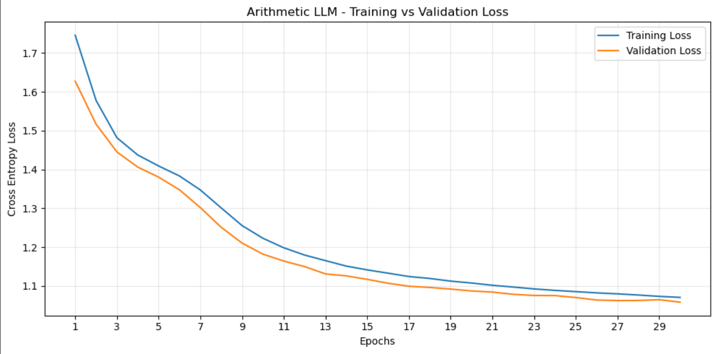

# Calc-LLM
This repository presents an LLM powered calculator. It's a experimental project to show how much non-linear functions are able to achieve proper computation.

A character-level autoregressive(Causal) Transformer built with PyTorch that learns to solve arithmetic problems through next-token prediction.

## LLM Blocks
The blocks that together makes the LLM possible though much of the things are not same. Like in GPT models Byte pair tokenizer were used but here as per the problem we are using Character level tokenizer.
Following are the blocks of the LLM:
<ol>
  <item><b>Tokenizer</b>: The tokenizer is a function that when gets input it breaks it into tokens which are common entities, the intutive idea is that language is made of blocks that together builds the context, tokens are the most fundamental ones which transforms the context based on groups formed.</item>
  <item><b>Token Embeddings</b>: The tokens previously were just ids the actual meaning of a token relates to the vector space or the feature space where it lies.</item>
  <item><b>Positional Embedding</b>: For large context the model may get confused what is the order of the sentence for which we use positional encodings that in the feature map helps the model to learn the ordering of the context. Though Causal attention accounts for it. But being a stateless machine it cannot be accurate and may hallucinate. Though here we are using random positional encoding; in the first attention paper they had given the sine-cosine positional encoding which is fixed.</item>
  <item><b>Transformer + NN</b>: Here is the feed network we send the feature embedding the attention blocks process and the Neural layer predicts the next token. Backpropagation and we get a trained model. </item>
</ol>
For generation part, we give prompt this prompt loops on generates next character until we get the token 'e' that represents the 'End Of Line'.

## Training
For 30 epochs the Model:
Epoch [1/30] Train Loss: 1.7456 Val Loss: 1.6274
Epoch [30/30] Train Loss: 1.0708 Val Loss: 1.0585

## Discussion on accuracy and measuring it.
I have not given the code to generate the accuracy since for different people LLMs accuracy measures are different.
For some the accuracy the next word generations how accurate it is from the test data.
For others it may happen that whole sequence if accurate then only it is correct. Also, some can add weightage to wrongs and corrects based on their understanding of the training.

For general discussion purpose the model has an accuracy of 73.48% (each equation answer is correct then only counted as correct else wrong.)
